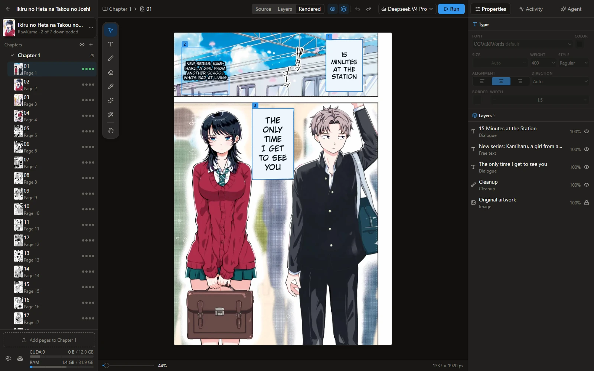
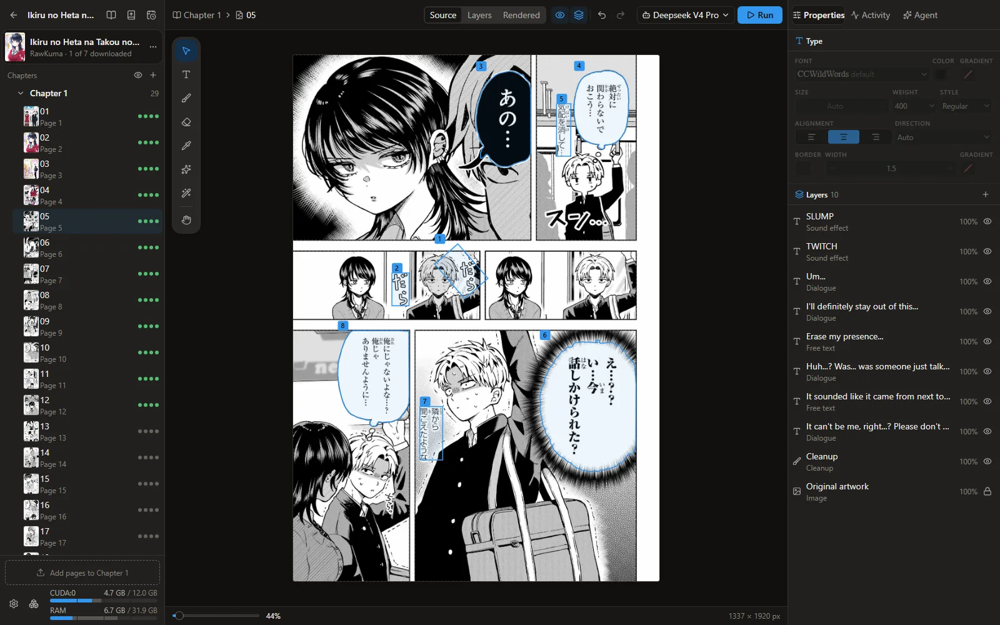
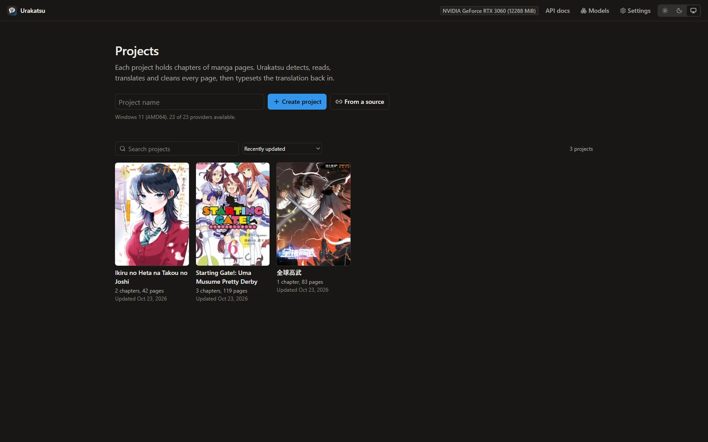
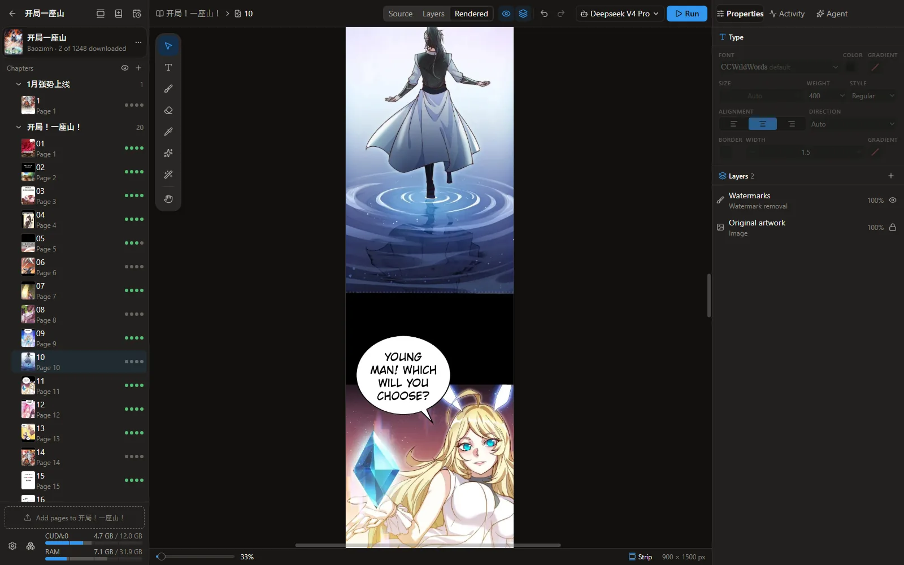
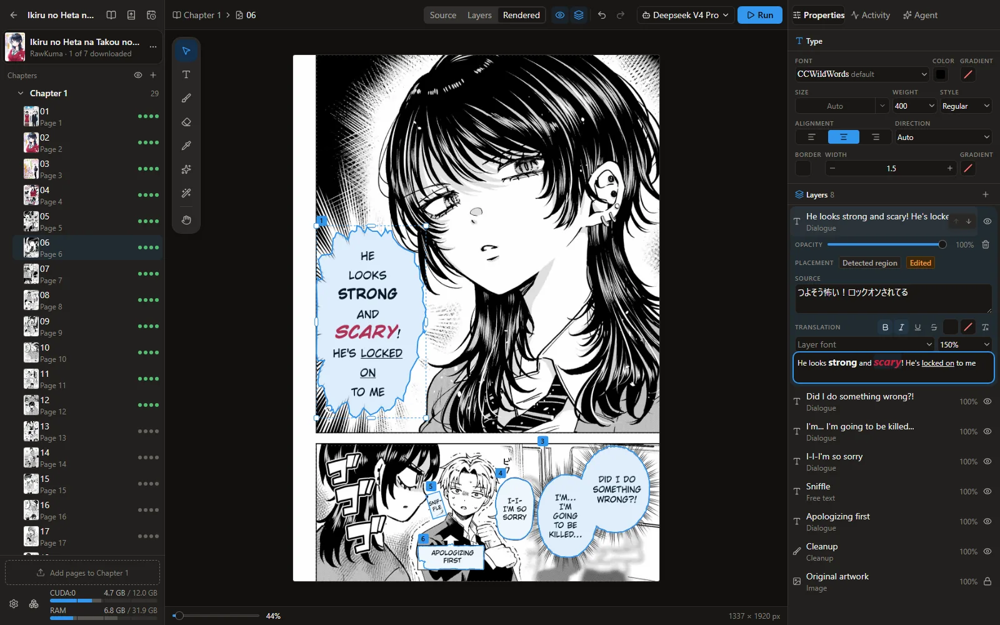
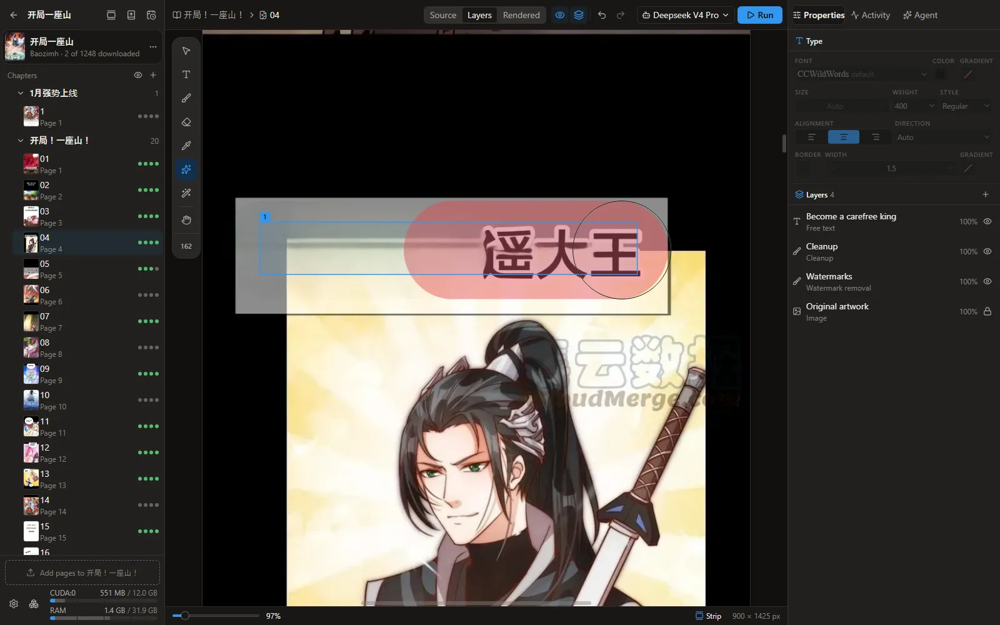
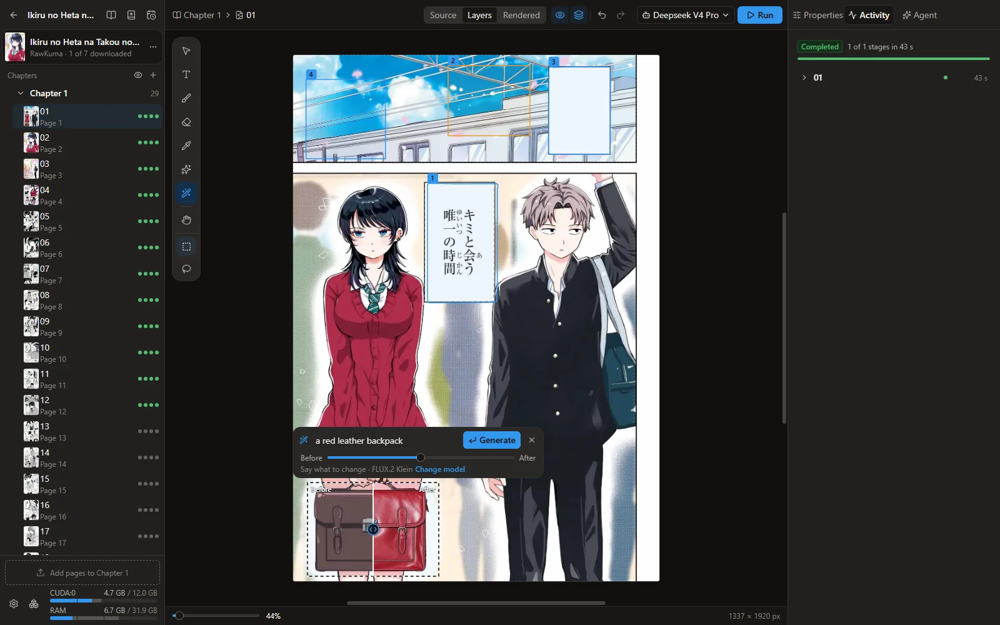
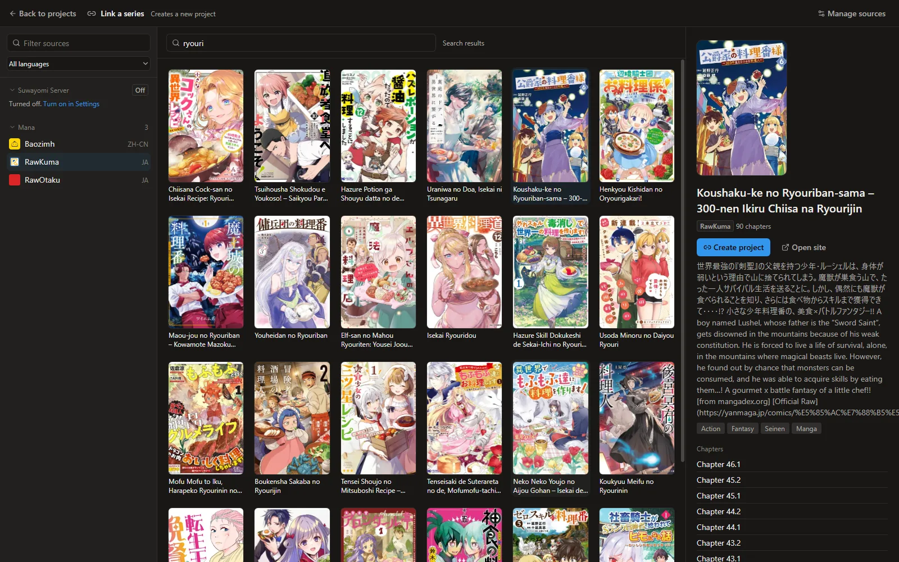
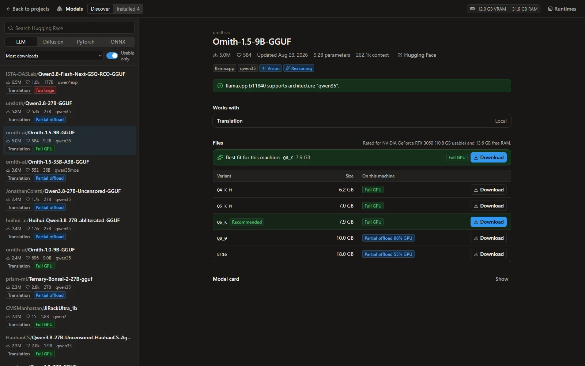

<p align="center">
  
</p>

<h1 align="center">Urakatsu</h1>

<p align="center">
  Detect, read, translate and typeset manga on your own computer.<br>
  A Python recreation of <a href="https://github.com/koharu-rs/koharu">Koharu</a>, with added features.
</p>



## Features

- **The whole pipeline, locally.** Text detection, OCR, translation, inpainting and typesetting,
  on an NVIDIA, AMD or Intel GPU, or on your CPU.
- **Edit everything.** Text blocks, rich text, typography, layers, cleanup brushes and generative
  fill. A re-run never overwrites your edits.
- **Chapters from the sites you read.** Download series from Suwayomi (Tachiyomi and Mihon
  extensions) and Mana sources straight into a project.
- **Webtoons, manhwa and manhua.** A webtoon project joins each chapter into one strip and
  cuts it again where no bubble, text or drawing is cut, then exports pages or one long strip.
- **Translate overnight.** Automations run chosen or new chapters on a schedule, one model at a
  time, so the largest models get the whole GPU, and can wake the computer to do it.
- **Read in Komga.** Export a project to a Komga server as a series, one book per chapter, by
  hand or as soon as an automation finishes the chapters.
- **Any model from Hugging Face.** Every download is rated for your GPU and RAM before you get
  it. Translate with a local model or a hosted one (Claude, OpenAI, DeepL and more).
- **Always current.** PyTorch, llama.cpp and stable-diffusion.cpp stay on their newest
  releases, and can be pinned when you need to.

| | |
| :---: | :---: |
|  |  |
| **Source view:** every detected text block, before translation | **Projects:** each series with its chapters and pages |
|  |  |
| **Webtoons:** a chapter read and edited as one long strip | **Rich text:** bold, italic, colour, size and font for any word |
|  |  |
| **Inpainting:** brush over anything to remove it | **Generative fill:** describe a change and compare before and after |
|  |  |
| **Sources:** search a site, link a series, download its chapters | **Models:** a Hugging Face catalog rated for your hardware |

## Contents

- [Quick install](#quick-install)
- [Development](#development)
- [Documentation](#documentation)
- [Acknowledgements](#acknowledgements)

## Quick install

### Requirements

| | |
| --- | --- |
| **System** | Windows 10 or 11 (64-bit), macOS 12 or newer on Apple silicon, or 64-bit Linux with WebKitGTK 4.1 (Ubuntu 22.04, Debian 12, Fedora 36 or newer) |
| **Graphics** | A GPU is recommended: NVIDIA (CUDA), AMD (ROCm or Vulkan), Intel Arc, any other with Vulkan, or Apple silicon. Without one, everything runs on the CPU, more slowly |
| **Disk** | About 6 GB for the app, plus 10 GB or more for models and projects |
| **Network** | Needed for setup and for downloading models |

### Install

1. Download the file for your system from the [latest release](../../releases/latest). For the
   newest changes, take the nightly build from the [releases page](../../releases) instead.

   | System | File |
   | --- | --- |
   | Windows | `Urakatsu-Setup-<version>.exe` |
   | macOS | `Urakatsu-<version>-macos-arm64.dmg` |
   | Linux | `Urakatsu-<version>-linux-x86_64.tar.gz` |

2. Start setup:
   - **Windows:** run the file. SmartScreen may warn about an unrecognized app: choose
     **More info**, then **Run anyway**.
   - **macOS:** open the disk image, then open **Urakatsu**. The first time, macOS blocks an app
     from an unidentified developer: open **System Settings**, then **Privacy & Security**, and
     select **Open Anyway**.
   - **Linux:** extract the file and run `Urakatsu`:

     ```bash
     tar -xzf Urakatsu-*-linux-x86_64.tar.gz && ./Urakatsu
     ```

3. Pick where Urakatsu keeps its data and models, or keep the defaults, then select **Install**.
   No administrator rights are needed.
4. Open Urakatsu. The first start sets up GPU support for your graphics card (about 3 GB, once).

Setup finds earlier installs: it offers to update an installed version, and lists data folders
from other installs with their projects and models, ready to reuse.

### Update and uninstall

- **Update:** run the newer download the same way. Your projects, models and settings stay.
- **Uninstall:** you choose whether your projects and models are deleted too.
  - **Windows:** open **Settings**, then **Apps**, then **Installed apps**, and uninstall
    Urakatsu.
  - **macOS:** run `~/Applications/Urakatsu.app/Contents/MacOS/Urakatsu --uninstall` in
    Terminal.
  - **Linux:** choose **Uninstall Urakatsu** on its applications menu entry, or run
    `~/.local/share/urakatsu/urakatsu --uninstall`.

More about the installer in [The desktop app](docs/app.md).

## Development

### Prerequisites

| Tool | Version | Needed for |
| --- | --- | --- |
| [uv](https://docs.astral.sh/uv/) | latest | The Python environment |
| Python | 3.11 or newer (3.14 recommended) | Urakatsu itself; uv can install it |
| [Node.js](https://nodejs.org/) | 22 or newer | Building the web UI |
| GPU driver | recent | GPU acceleration (optional) |
| [Rust](https://rustup.rs/) | stable | Building the installer only (on Linux, also `libwebkit2gtk-4.1-dev` and `libgtk-3-dev`) |

### Set up

From a clone of this repository:

```bash
uv venv --python 3.14
```

Install PyTorch for your GPU, then Urakatsu. `urakatsu devices` lists the GPUs Urakatsu finds.

**NVIDIA** (CUDA):

```bash
uv pip install -e ".[torch,onnx-gpu,dev]" --index-url https://download.pytorch.org/whl/cu132 --extra-index-url https://pypi.org/simple --index-strategy unsafe-best-match
```

**AMD** (ROCm). Replace `gfx1100` with your GPU's ISA; on Linux, use `onnx` instead of
`onnx-directml`:

```bash
uv pip install "torch[device-gfx1100]" "torchvision[device-gfx1100]" --prerelease allow --index-url https://stable.repo.amd.com/rocm/whl-next
uv pip install -e ".[torch,onnx-directml,dev]"
```

**Intel Arc** (XPU):

```bash
uv pip install torch torchvision --index-url https://download.pytorch.org/whl/xpu
uv pip install -e ".[torch,onnx-directml,dev]"
```

**No GPU**, or any other GPU (llama.cpp and stable-diffusion.cpp still use it through Vulkan):

```bash
uv pip install -e ".[torch,onnx,dev]"
```

Activate the environment (`.venv\Scripts\activate` on Windows, `source .venv/bin/activate`
elsewhere), then build the web UI:

```bash
cd web && npm install && npm run build && cd ..
```

### Run

```bash
urakatsu serve
```

Open http://127.0.0.1:8090. The newest llama.cpp and stable-diffusion.cpp releases install the
first time a model needs them; `urakatsu runtimes update` installs them up front.

To work on Urakatsu, run both servers from one terminal instead:

```bash
urakatsu dev
```

Then open http://localhost:5173. The UI hot-reloads as you edit `web/src`, and the service on
port 8090 restarts when a Python file under `urakatsu/` changes. Ctrl+C stops both. If another
program holds 8090 or 5173, the next free port is used and printed;
`--port` and `--ui-port` ask for specific ones. `--no-web` runs only the service, and
`--no-reload` turns the restarts off. Native gRPC is off in dev (`--grpc-port 50051` turns it on); the UI does not use it.

To run the Vite dev server against a service you started yourself, start it in `web/`:
`npm run dev` proxies to port 8090, or to `URAKATSU_API` if set.

### Run models on another machine

Detection, OCR and inpainting models can run on a GPU elsewhere, such as a Colab or Kaggle
notebook or a server. Install Urakatsu there and start a worker:

```bash
urakatsu worker --port 8100
```

It prints a token. To reach a notebook from your machine, expose the port with a tunnel, for
example `cloudflared tunnel --url http://localhost:8100`. In the app, open Settings, Pipeline,
pick the model, set its runtime to `remote`, and enter the worker's address and token. The
worker runs the same model code on its own runtime, downloads the weights itself, and keeps
one model per stage loaded. Loads and inference run as background jobs that the app polls, so
no request stays open long enough for a tunnel to cut it, however slow the model is.

Or let Urakatsu Cloud run them: make a key at [urakatsu.com](https://urakatsu.com/dashboard/keys),
enter it under Settings, Providers, Urakatsu Cloud, and set a model's runtime to Urakatsu Cloud.
The same key translates with the Urakatsu Cloud translation provider. The free plan covers 50
pages a week.

Nano Banana 2.1, Google's image model, is an inpainting model for generative fill and sound
effects. Run it on your own Gemini API key (from Google AI Studio, in its options or
`GEMINI_API_KEY`; runtime Gemini API), or on Urakatsu Cloud with a key that has image
generation allowed. Only the area you select changes.

PaddleOCR-VL, FLUX.2 Klein and RORem can also use a llama-server or sd-server that someone
else started: keep their runtime on `llama` or `diffusion` and set Server URL. That server must
be started with the model's weights (PaddleOCR-VL also needs its `--mmproj` and a context of at
least 4096).

### Test

```bash
pytest
```

The suite runs offline against synthetic pages. Tests that need real model weights are skipped
unless these are set:

| Variable | Points to |
| --- | --- |
| `KOHARU_ROOT` | A Koharu checkout, for its fixture page |
| `URAKATSU_TEST_HOME` | A data folder that holds the OCR weights |
| `URAKATSU_WEIGHTS_HOME` | A models folder that holds the inpainting weights |

### Build the installer

```bash
python packaging/build.py
```

This builds the installer for the system it runs on into `dist/`: the setup exe on Windows, a
disk image on macOS, a tarball on Linux (needs Node.js and Rust).

### CI and releases

Every push and pull request runs the tests on Windows, macOS and Linux, checks and builds the
web UI, and builds all three installers. A `vX.Y.Z` tag publishes a release; main is also
published every night as the `nightly` pre-release. See [CI and releases](docs/releases.md).

### Project rules

[AGENTS.md](AGENTS.md) lists the principles every change follows: the newest runtimes, Koharu
parity, and swappable providers.

## Documentation

| Guide | What it covers |
| --- | --- |
| [Architecture](docs/architecture.md) | Code layout, pipeline semantics, service modes, the API, the web UI, writing a provider |
| [Models](docs/models.md) | Default models, the Hugging Face catalog, diffusion inpainting, hosted translation, page storage |
| [Sources](docs/sources.md) | Source systems, linking a series, the built-in browser |
| [Automations](docs/automations.md) | Scheduled batches, model profiles, waking the computer |
| [Komga](docs/komga.md) | Connecting a Komga server, projects as series, exporting chapters |
| [Webtoons](docs/webtoons.md) | Webtoon projects, how strips are restitched, the cut settings |
| [Runtimes](docs/runtimes.md) | How runtimes stay current, the `urakatsu runtimes` commands, pinning a release |
| [The desktop app](docs/app.md) | What setup does on each system, the app environment, command-line options, building |
| [CI and releases](docs/releases.md) | The GitHub workflows, publishing a release, nightly builds |

## Acknowledgements

Urakatsu follows [Koharu](https://github.com/koharu-rs/koharu)'s pipeline, scene model and
typesetting, and runs on [llama.cpp](https://github.com/ggml-org/llama.cpp),
[stable-diffusion.cpp](https://github.com/leejet/stable-diffusion.cpp),
[PyTorch](https://pytorch.org/), [Suwayomi Server](https://github.com/Suwayomi/Suwayomi-Server)
and [Bun](https://bun.sh/). Webtoon slicing follows
[SmartStitch](https://github.com/MechTechnology/SmartStitch)'s pixel comparison.

Licensed under the [MIT license](LICENSE). Koharu's copyright and license notices, which
Urakatsu keeps, are in [NOTICE](NOTICE).
